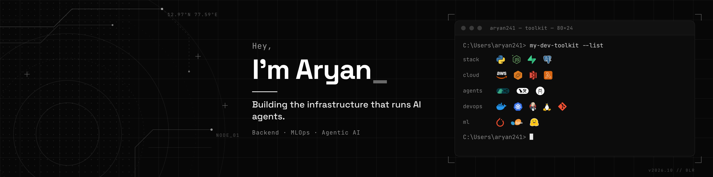

<h2>Hey, I'm Aryan 👋</h2>

Student developer from Bengaluru, **building the infrastructure that runs AI agents.**
I work on the unglamorous parts: backends, eval harnesses, monitoring and deployment, the stuff that keeps agents and ML models honest in production.

`Backend` · `MLOps` · `Agentic AI`

### Toolkit

| | |
|:--|:--|
| **stack** |     |
| **cloud** |     |
| **agents** |    |
| **devops** |      |
| **ml** |    |

### What I'm building

**[RegressionGate](https://github.com/risaryan9/regressiongate)**: CI eval and tracing harness for tool-using LLM agents. Every prompt or model change replays a versioned dataset through deterministic checks (tool calls, actions, cost, latency) and then a cached LLM-as-judge. Pass-rate regressions fail a required GitHub Actions check and block the merge, and every run is stored as a span tree of LLM and tool calls, so a failing case traces back to the exact step that broke.
`Python` `Claude` `LLM-as-judge` `Tracing` `GitHub Actions`

**[Plainsight](https://github.com/risaryan9/plainsight)** *(in progress)*: agentic APK threat-analysis pipeline. Androguard static analysis (APKs are never executed) runs in a containerised AWS Lambda worker. ML anomaly scores with SHAP explanations feed a LangGraph multi-agent system on Claude, which checks the app's permissions and behaviour against what it claims to do. The scores are computed in code, and the LLM only explains them.
`Python` `LangGraph` `Claude` `AWS Lambda` `S3` `FastAPI`

**[Seraph](https://github.com/risaryan9/project-seraph)**: distributed telemetry pipeline for concurrent ML workloads, with phase-level attribution (train / infer / data). Instrumented jobs publish 13 resource metrics to partitioned Kafka topics. Consumer groups batch-write them (50 samples / 500 ms) to InfluxDB, tagged by model and phase, and FastAPI serves them over REST and WebSocket to an [observability console](https://github.com/risaryan9/project-seraph-frontend).
`Python` `Kafka` `InfluxDB` `FastAPI` `Docker`

### Stats

  
  

  

